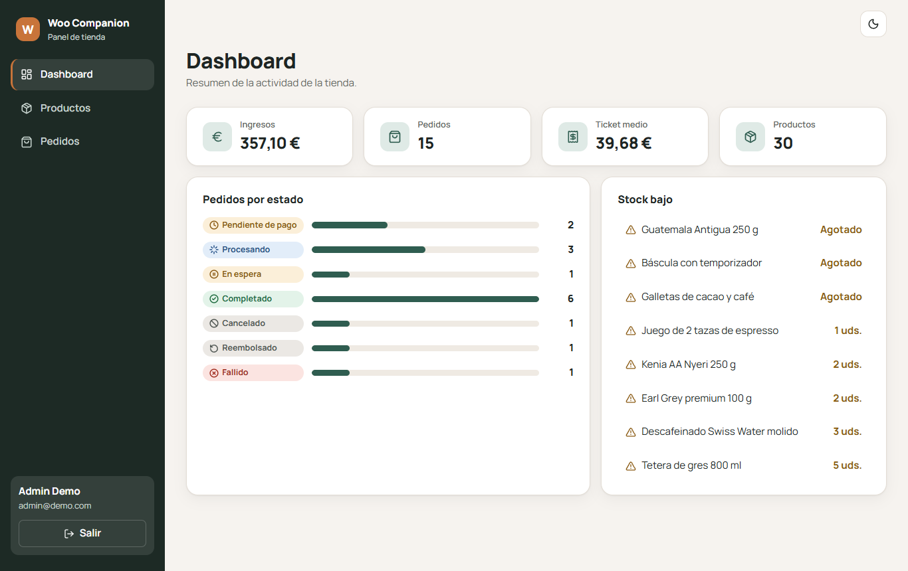
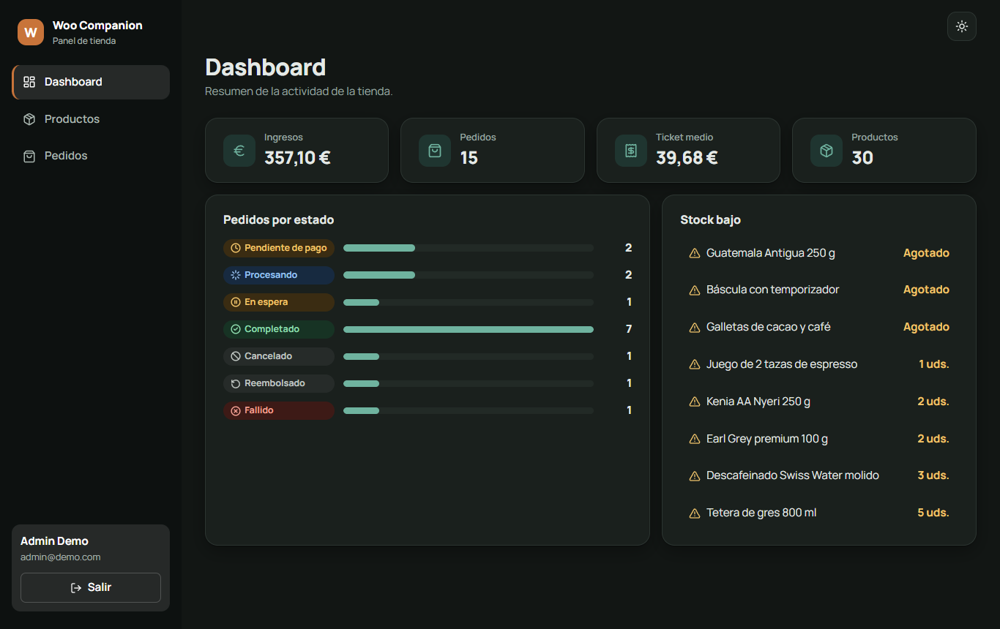
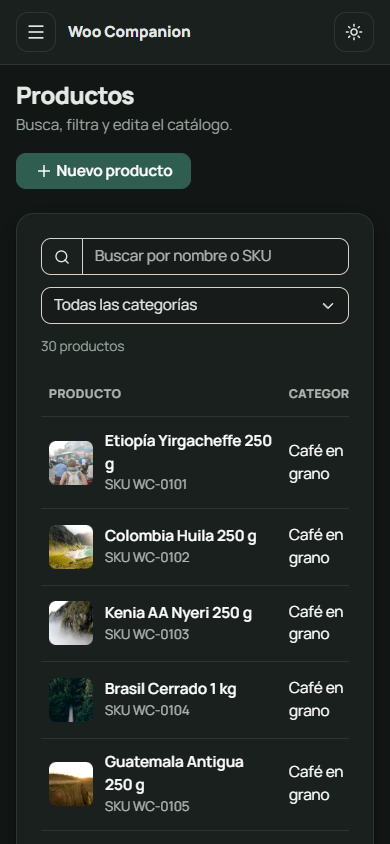
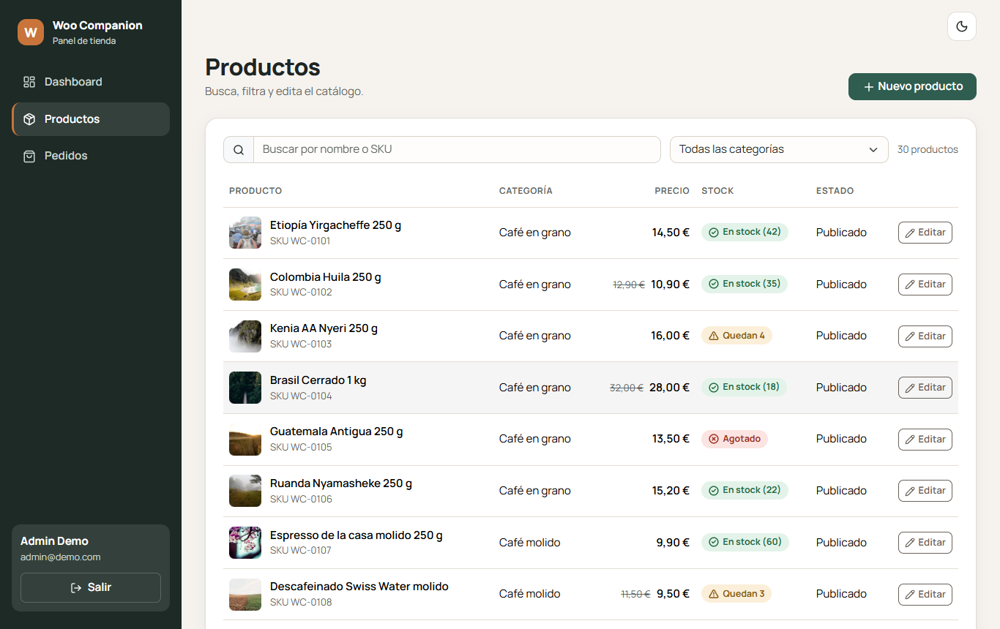
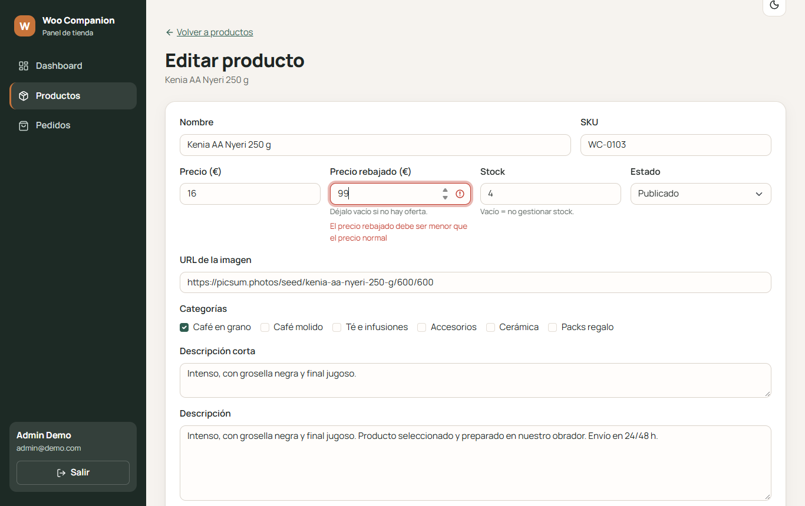
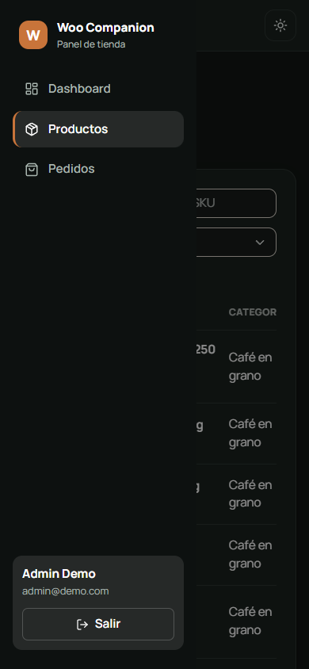
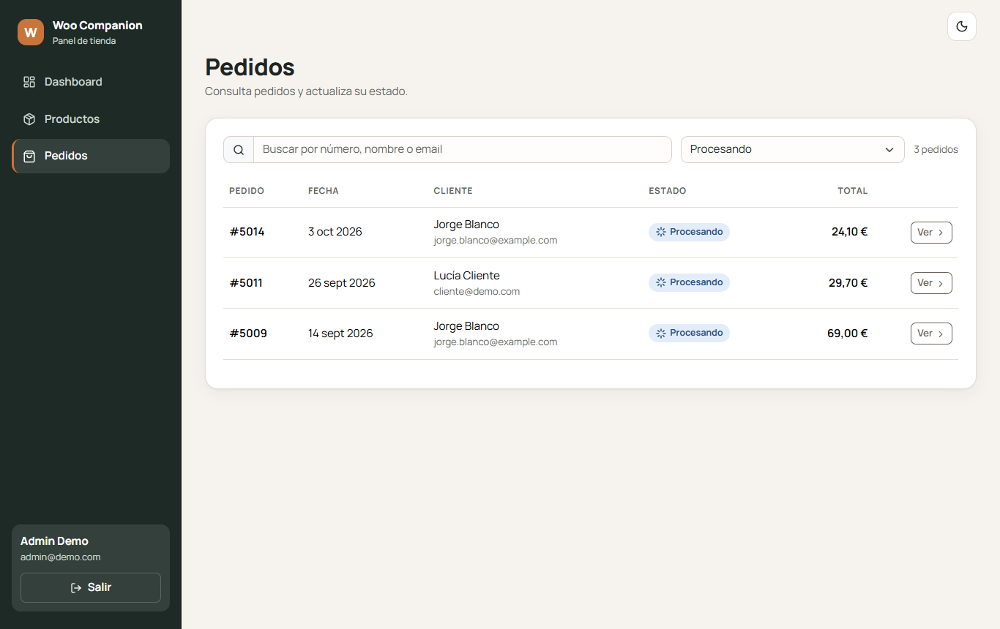
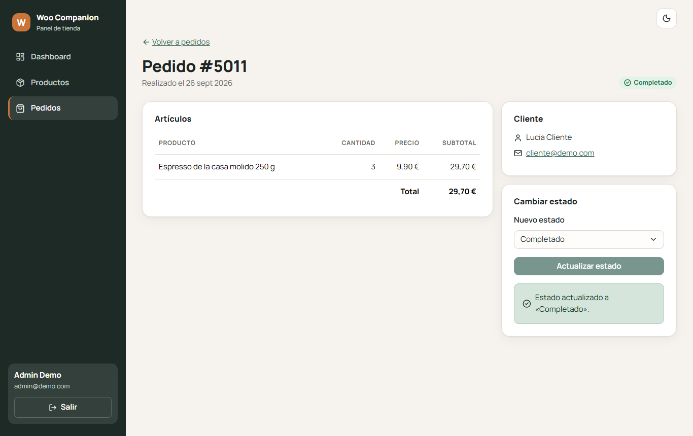
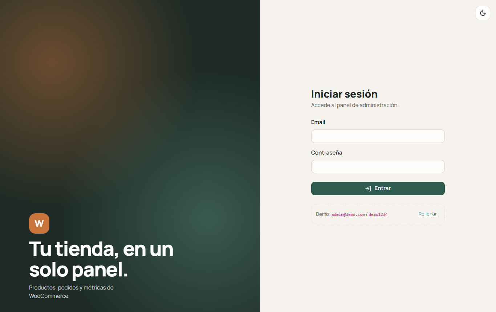

# Woo Companion

Tienda con **dos clientes sobre la misma API**: un panel de administración web (React + Bootstrap) y una app de cliente móvil (React Native + Expo). La API es un proxy en Express hacia WooCommerce. También puede funcionar sin tienda en **modo mock**, con datos de ejemplo.

Todo está escrito en TypeScript, en un monorepo con npm workspaces.

| Panel web                                        | Modo oscuro                                                                    | Responsive                                          |
| ------------------------------------------------ | ------------------------------------------------------------------------------ | --------------------------------------------------- |
|  |                    |   |
|   |  |  |
|       |                     |             |

> Las capturas de la app móvil se añaden a mano desde Expo Go (guárdalas en `docs/screenshots/mobile-*.png`).

---

## Qué incluye

**Panel web (`apps/web`)**: login con rutas protegidas, dashboard con métricas, productos (búsqueda, filtro por categoría, paginación, crear y editar), pedidos (filtros, detalle y cambio de estado). Tema de Bootstrap personalizado con Sass, layout hecho a mano con CSS Modules y Grid, modo oscuro con variables CSS, diseño responsive y accesible (los estados se comunican con icono + texto, no solo con color).

**App móvil (`apps/mobile`)**: pestañas Catálogo, Favoritos, Carrito y Pedidos. Catálogo con FlatList, búsqueda, filtros, _pull to refresh_, _scroll_ infinito y detalle de producto. Favoritos persistidos en AsyncStorage, carrito con Context + `useReducer`, login con el token en SecureStore, y un checkout simulado que crea el pedido y lanza una notificación local.

**API (`apps/api`)**: Express 5 con validación zod, login demo con JWT y dos fuentes de datos intercambiables: `mock` (JSON en memoria) y `woo` (WooCommerce REST API v3).

**Compartido (`packages/shared`)**: esquemas zod, tipos y cliente de API tipado, que usan tanto la web como el móvil.

## Arquitectura

```
┌───────────────────┐      ┌────────────────────┐
│ apps/web          │      │ apps/mobile        │
│ React + Vite      │      │ Expo + Expo Router │
│ (panel admin)     │      │ (app cliente)      │
└─────────┬─────────┘      └─────────┬──────────┘
          │  packages/shared: tipos, zod, cliente de API
          └──────────────┬───────────┘
                         ▼  HTTP + JWT
               ┌───────────────────┐
               │ apps/api          │   DATA_SOURCE=mock → fixtures JSON
               │ Express :4000     │───────────────────────────────────
               │ (claves aquí)     │   DATA_SOURCE=woo  → WooCommerce REST
               └───────────────────┘
```

```
woo-companion/
├─ apps/
│  ├─ api/          Express, rutas, auth JWT, fuentes de datos mock/woo, fixtures
│  ├─ web/          React + Vite + react-bootstrap + TanStack Query + react-hook-form
│  └─ mobile/       Expo SDK 57 + Expo Router (src/app), Context, AsyncStorage, SecureStore
├─ packages/
│  └─ shared/       esquemas zod, tipos, cliente de API, formateadores
└─ docs/
   ├─ DECISIONES.md cada decisión técnica explicada
   └─ screenshots/
```

| Paquete | Versiones principales                                                                                        |
| ------- | ------------------------------------------------------------------------------------------------------------ |
| Raíz    | TypeScript 6.0, ESLint 10, Prettier 3.9, Vitest 5                                                            |
| api     | Express 5.2, jsonwebtoken 9, zod 4, tsx                                                                      |
| web     | React 19.2, Vite 8, React Router 7, TanStack Query 5, react-bootstrap 2.10, Bootstrap 5.3, react-hook-form 7 |
| mobile  | Expo SDK 57, React Native 0.86, Expo Router 57                                                               |

Las razones de cada elección están en [docs/DECISIONES.md](docs/DECISIONES.md).

---

## Guía paso a paso desde un clon limpio

### 1. Requisitos

- **Node.js 24 LTS** (≥ 24.15) o **22** (≥ 22.22.2). Comprueba tu versión con `node -v`. Con versiones algo anteriores funciona, pero npm muestra avisos `EBADENGINE`.
- **npm 10 o superior** (viene con Node).
- **Git**.
- Para el móvil: la app **Expo Go** (App Store / Google Play) actualizada a la última versión, que es la compatible con SDK 57. El teléfono y el PC deben estar en la **misma red WiFi**.

### 2. Instalación

```bash
git clone <url-del-repo> woo-companion
cd woo-companion
npm install
```

Un único `npm install` en la raíz instala los cuatro paquetes.

### 3. Variables de entorno

Cada app tiene su `.env.example`. Copia los que necesites:

```bash
# macOS / Linux / Git Bash
cp apps/api/.env.example apps/api/.env
cp apps/web/.env.example apps/web/.env
cp apps/mobile/.env.example apps/mobile/.env
```

```powershell
# Windows PowerShell
Copy-Item apps/api/.env.example apps/api/.env
Copy-Item apps/web/.env.example apps/web/.env
Copy-Item apps/mobile/.env.example apps/mobile/.env
```

| App    | Variable                           | Para qué                                        | Valor por defecto       |
| ------ | ---------------------------------- | ----------------------------------------------- | ----------------------- |
| api    | `PORT`                             | Puerto de la API                                | `4000`                  |
| api    | `DATA_SOURCE`                      | `mock` o `woo`                                  | `mock`                  |
| api    | `JWT_SECRET`                       | Firma de los tokens (obligatoria en producción) | uno de desarrollo       |
| api    | `CORS_ORIGINS`                     | Orígenes web permitidos, separados por comas    | `http://localhost:5173` |
| api    | `WOO_URL`, `WOO_KEY`, `WOO_SECRET` | Solo para `DATA_SOURCE=woo`                     | —                       |
| web    | `VITE_API_URL`                     | URL de la API, sin `/api`                       | `http://localhost:4000` |
| mobile | `EXPO_PUBLIC_API_URL`              | URL de la API **vista desde el teléfono**       | `http://localhost:4000` |

> En modo mock, la API y la web funcionan **sin ningún `.env`**. El del móvil sí es necesario si usas un teléfono físico (paso 6).

### 4. Arrancar (cada comando en su propia terminal, en este orden)

```bash
npm run dev:api      # 1º  API en http://localhost:4000/api (modo mock)
npm run dev:web      # 2º  Panel en http://localhost:5173
npm run dev:mobile   # 3º  Expo: muestra un QR para Expo Go
```

Comprueba que la API responde: abre http://localhost:4000/api/health y deberías ver `{"status":"ok","dataSource":"mock"}`.

### 5. Credenciales demo

| Usuario            | Contraseña | Rol     | Dónde                                   |
| ------------------ | ---------- | ------- | --------------------------------------- |
| `admin@demo.com`   | `demo1234` | admin   | Panel web (y también la app)            |
| `cliente@demo.com` | `demo1234` | cliente | App móvil (ya tiene pedidos de ejemplo) |

Las dos pantallas de login tienen un botón para rellenar las credenciales demo. En modo mock los cambios se guardan en memoria y **se reinician al reiniciar la API**.

### 6. Abrir la app en un teléfono físico con Expo Go

1. **Averigua la IP local de tu PC**:
   - Windows: `ipconfig` → «Dirección IPv4» del adaptador WiFi (por ejemplo `192.168.1.50`).
   - macOS: `ipconfig getifaddr en0`
   - Linux: `hostname -I`
2. Escríbela en `apps/mobile/.env`:
   ```
   EXPO_PUBLIC_API_URL=http://192.168.1.50:4000
   ```
3. Comprueba desde el **navegador del teléfono** que abre `http://192.168.1.50:4000/api/health`. Si no carga, revisa el cortafuegos (ver «Errores comunes»).
4. Arranca Expo limpiando la caché (necesario cada vez que cambias el `.env`):
   ```bash
   npm run dev:mobile -- --clear
   ```
5. Escanea el QR: en Android desde Expo Go, en iOS con la cámara.
6. Prueba el flujo completo: añade productos al carrito → Finalizar compra → inicia sesión con `cliente@demo.com` → Confirmar pedido. Acepta el permiso de notificaciones y verás la notificación y el pedido en la pestaña «Pedidos».

Para emuladores: en el de Android usa `http://10.0.2.2:4000`; en el simulador de iOS sirve `http://localhost:4000`.

### 7. Pasar de modo mock a una tienda WooCommerce real

1. En WordPress: **WooCommerce → Ajustes → Avanzado → API REST → Añadir clave**. Elige un usuario administrador y permisos de **Lectura/Escritura**. Copia la _Consumer key_ (`ck_…`) y la _Consumer secret_ (`cs_…`); solo se muestran una vez.
2. Edita `apps/api/.env`:
   ```
   DATA_SOURCE=woo
   WOO_URL=https://tu-tienda.com
   WOO_KEY=ck_xxxxxxxx
   WOO_SECRET=cs_xxxxxxxx
   ```
3. Reinicia la API (`npm run dev:api`). Verás `modo woo` y `Conectada a https://tu-tienda.com`.
4. La web y el móvil no cambian: siguen hablando con la misma API.

**Tienda local sin HTTPS (por ejemplo LocalWP):** WooCommerce solo acepta sus claves `ck_/cs_` por HTTPS. En local tienes dos opciones:

- Activar SSL en LocalWP.
- Usar una **contraseña de aplicación** de WordPress (Usuarios → Perfil → Contraseñas de aplicación) con `WOO_KEY=tu_usuario_admin` y `WOO_SECRET=la contraseña de aplicación`. WordPress solo la acepta por HTTP en entornos marcados como `local`; LocalWP normalmente lo hace por defecto.

**Ten en cuenta:** el login de la app sigue siendo el demo (los usuarios no se sincronizan con los clientes de WordPress). «Mis pedidos» busca en WooCommerce los pedidos con el email del usuario demo, y el checkout crea pedidos reales en estado «Procesando» con pago simulado. **Prueba primero en una tienda de pruebas.**

### 8. Tests, lint y formato

```bash
npm test             # 40 tests (shared, api, web, mobile) con Vitest
npm run lint         # ESLint en todo el monorepo
npm run typecheck    # tsc en los cuatro paquetes
npm run format       # Prettier
```

---

## Despliegue

### Web y API en Vercel (dos proyectos del mismo repo)

La web es una SPA estática y necesita una API pública. La forma más sencilla es crear **dos proyectos de Vercel** que apunten al mismo repositorio:

| Proyecto | Root Directory           | Variables de entorno                                                                                  |
| -------- | ------------------------ | ----------------------------------------------------------------------------------------------------- |
| API      | `apps/api`               | `DATA_SOURCE=mock`, `JWT_SECRET=<cadena larga aleatoria>`, `CORS_ORIGINS=https://<tu-web>.vercel.app` |
| Web      | `apps/web` (preset Vite) | `VITE_API_URL=https://<tu-api>.vercel.app`                                                            |

1. Sube el repo a GitHub.
2. Vercel → **Add New → Project** → importa el repo → _Root Directory_ `apps/api` → añade las variables → Deploy. Abre `https://<tu-api>.vercel.app/api/health`.
3. Repite el paso con _Root Directory_ `apps/web` y `VITE_API_URL` apuntando a la API.
4. Vuelve al proyecto de la API y ajusta `CORS_ORIGINS` con la URL final de la web (requiere un _Redeploy_).

Detalles:

- `apps/web/vercel.json` redirige todas las rutas a `index.html`, para que recargar en `/products` no dé 404.
- La API usa `src/index.ts`, que Vercel detecta como punto de entrada de Express.
- **En Vercel el modo mock no guarda los cambios de forma fiable**: cada instancia serverless tiene su propia memoria y se reinicia. Para la demo es suficiente.
- La configuración de Vercel de este repo **no está probada con un despliegue real**. Si Vercel no compila el paquete `@woo/shared` (que se importa como TypeScript), la alternativa es desplegar la API en un servicio Node clásico (Render, Railway, Fly.io) con el comando `npm run start --workspace @woo/api`.

### App móvil con Expo Go

Para enseñarla en una entrevista basta con `npm run dev:mobile` y Expo Go en la misma red. Si la API está desplegada, pon su URL pública en `EXPO_PUBLIC_API_URL` y la app funcionará desde cualquier red. Si tu red bloquea la conexión entre dispositivos, usa `npm run dev:mobile -- --tunnel` (el túnel solo cubre Metro; la API tiene que ser accesible por su cuenta).

---

## Errores comunes

| Síntoma                                                                     | Causa                                                   | Solución                                                                                                                                                   |
| --------------------------------------------------------------------------- | ------------------------------------------------------- | ---------------------------------------------------------------------------------------------------------------------------------------------------------- |
| La app móvil dice «No se pudo conectar con la API en http://localhost:4000» | En el teléfono, `localhost` es el propio teléfono       | Pon la IP del PC en `EXPO_PUBLIC_API_URL` y arranca con `npm run dev:mobile -- --clear`                                                                    |
| Cambié `EXPO_PUBLIC_API_URL` y la app sigue usando la URL vieja             | Expo incrusta la variable en el bundle al arrancar      | Para Expo y arráncalo con `-- --clear`                                                                                                                     |
| El teléfono no abre `http://IP:4000/api/health`                             | Cortafuegos de Windows o red de invitados aislada       | Permite Node.js en redes **privadas** (Windows Defender Firewall → Permitir una aplicación), marca la WiFi como red privada y evita las redes de invitados |
| Expo Go: «Project is incompatible with this version of Expo Go»             | Expo Go desactualizado                                  | Actualiza Expo Go desde la tienda (debe soportar SDK 57)                                                                                                   |
| El QR abre pero se queda cargando                                           | El teléfono no llega al puerto 8081 de Metro            | Mismo cortafuegos que arriba (puerto 8081) o usa `-- --tunnel`                                                                                             |
| Web: «No se pudo conectar con la API…»                                      | La API no está arrancada o `VITE_API_URL` es incorrecta | Lanza `npm run dev:api` y abre `/api/health`                                                                                                               |
| Web: error de CORS en la consola                                            | El origen de la web no está en `CORS_ORIGINS`           | Añádelo en `apps/api/.env` (separado por comas) y reinicia la API                                                                                          |
| `localhost:5173` rechaza la conexión                                        | El puerto está ocupado (`strictPort`)                   | Cierra el otro proceso de Vite o cambia el puerto en `vite.config.ts`                                                                                      |
| «Invalid hook call» / dos copias de React                                   | Alguien instaló otra versión de React                   | `npm ls react` debe mostrar solo 19.2.3. Borra `node_modules` y `package-lock.json` y ejecuta `npm install`                                                |
| La API no arranca: «DATA_SOURCE=woo necesita WOO_URL…»                      | Faltan variables de WooCommerce                         | Rellénalas o vuelve a `DATA_SOURCE=mock`                                                                                                                   |
| Modo woo: «WooCommerce: Lo siento, no puedes listar los recursos» (401)     | Claves incorrectas, sin permisos o tienda por HTTP      | Revisa los permisos de lectura/escritura y usa HTTPS o una contraseña de aplicación (paso 7)                                                               |
| Modo woo: 404 en `/wp-json/wc/v3`                                           | Enlaces permanentes «simples» en WordPress              | Ajustes → Enlaces permanentes → «Nombre de la entrada»                                                                                                     |
| `npm install` avisa `EBADENGINE`                                            | Node algo antiguo                                       | Actualiza a Node 24.15+ o 22.22.2+                                                                                                                         |
| `npm audit` muestra vulnerabilidades                                        | Dependencias internas de las herramientas de Expo       | No ejecutes `audit fix --force` (rompe el SDK). Ver DECISIONES.md                                                                                          |
| La app móvil no funciona en el navegador                                    | SecureStore no existe en web                            | La app es solo para iOS/Android (Expo Go, emulador o simulador)                                                                                            |
| No llega la notificación tras el pedido                                     | Permiso denegado                                        | Actívalo en Ajustes → Notificaciones → Expo Go. Mientras tanto la app muestra un aviso en pantalla                                                         |

---

## Scripts de la raíz

| Script               | Qué hace                                                      |
| -------------------- | ------------------------------------------------------------- |
| `npm run dev:api`    | API con recarga automática (tsx watch)                        |
| `npm run dev:web`    | Servidor de Vite del panel                                    |
| `npm run dev:mobile` | `expo start` (admite argumentos: `-- --clear`, `-- --tunnel`) |
| `npm run build:web`  | Typecheck + build de producción de la web                     |
| `npm test`           | Todos los tests con Vitest                                    |
| `npm run lint`       | ESLint                                                        |
| `npm run typecheck`  | `tsc --noEmit` en cada workspace                              |
| `npm run format`     | Prettier                                                      |
